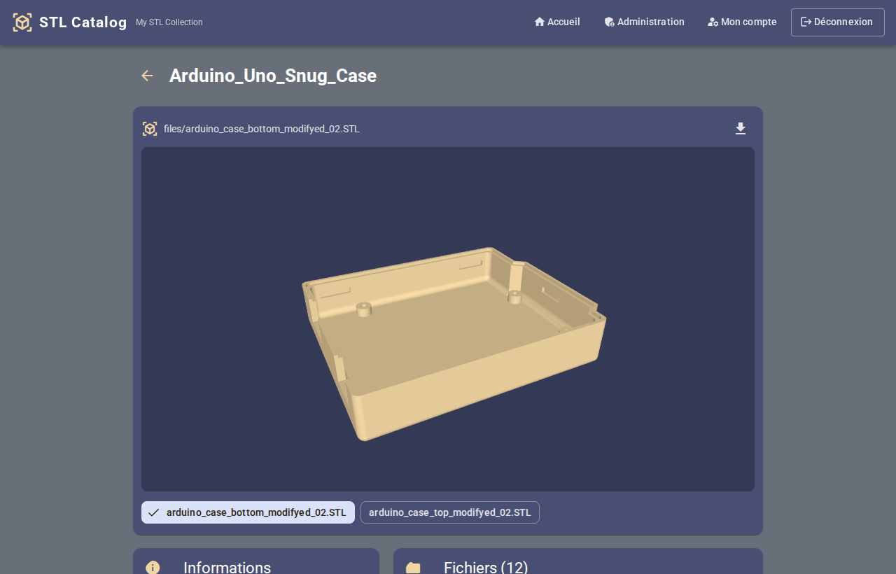
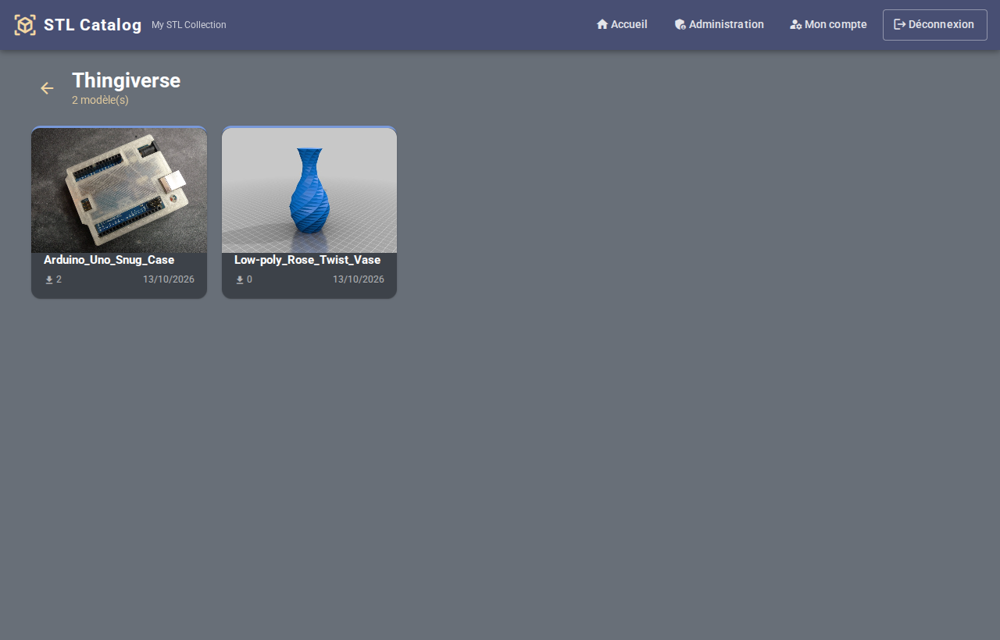
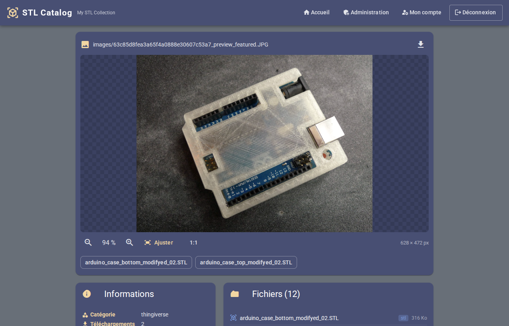

# STL Catalog

Catalogue web de modèles d'impression 3D, auto-hébergé. On dépose ses modèles (dossiers ou
archives zip / rar / 7z) dans un dossier, le catalogue les indexe tout seul et permet de les
**visualiser en 3D dans le navigateur** sans rien décompresser à la main.

© 2020–2026 Nicolas ELIE



## Fonctionnalités

- **Indexation automatique** du dossier `modeles/` au démarrage, toutes les 10 minutes et à la
  demande (bouton *Rescanner* dans l'administration). Ajouts, modifications et suppressions sont
  répercutés en base.
- **Archives zip, rar et 7z** lues sans extraction complète : seul le fichier consulté est
  extrait, puis mis en cache.
- **Viewer 3D** ([Online 3D Viewer](https://github.com/kovacsv/Online3DViewer)) : STL, OBJ+MTL,
  3MF, STEP/IGES, PLY, AMF, OFF, glTF, FBX, 3DS, DAE.
- **Aperçu de tous les fichiers** d'un modèle : images (zoom, taille réelle 1:1, déplacement),
  textes (README, gcode…), PDF.
- **Téléchargement** du modèle complet (archive d'origine, ou zip généré pour un dossier) ou
  d'un fichier seul.
- **Catégories avec niveaux d'accès** : 0 = public, 1 = modérateur, 2 = administrateur.

| Liste d'une catégorie | Visualiseur d'images |
| --- | --- |
|  |  |

## Installation

Prérequis : une machine avec Docker et Docker Compose (testé sur Raspberry Pi 5, arm64).

```bash
git clone git@github.com:themaire/catalog.git
cd catalog
cp .env.example .env
```

Renseigner dans `.env` au minimum les secrets (par exemple avec `openssl rand -hex 32`) :

- `DB_ROOT_PASSWORD`, `DB_PASSWORD` : mots de passe MariaDB
- `JWT_SECRET` : clé de signature des sessions

Puis :

```bash
docker compose up -d --build
```

Le catalogue est accessible sur `http://<ip-de-la-machine>:8090` (port réglable via
`FRONTEND_PORT`).

**Premier démarrage** : se connecter avec `admin` / `admin`, puis changer immédiatement le mot de
passe dans *Mon compte*.

## Ajouter des modèles

Les modèles se rangent dans `modeles/<catégorie>/` (dossier configurable via `MODELS_DIR`) :

```
modeles/
├── thingiverse/                  ← une catégorie = un dossier
│   ├── Arduino_Uno_Snug_Case/    ← un modèle = un dossier…
│   │   ├── files/boitier.stl
│   │   └── images/photo.jpg
│   └── Support_casque.zip        ← … ou une archive zip / rar / 7z
└── perso/
```

- Une catégorie inconnue est créée automatiquement au niveau `SCAN_NEW_CATEGORY_LEVEL`
  (1 = modérateur par défaut). Pour la rendre publique, passer son niveau à 0 dans
  *Administration*.
- La vignette d'un modèle est la première image trouvée dans son dossier ou son archive.
- Le dossier est monté **en lecture seule** : le catalogue ne modifie jamais les modèles.
- Seuls les exemples `modeles/thingiverse/` sont versionnés, le reste du dossier est ignoré par
  git.

## Mise à jour

```bash
git pull
docker compose up -d --build
```

Les données (base MariaDB, cache des fichiers extraits) sont dans les volumes Docker `db-data` et
`extract-cache` et survivent aux mises à jour.

## Architecture

| Service | Rôle |
| --- | --- |
| `frontend` | Angular servi par Nginx, proxy `/api` vers le backend ([modern/frontend](modern/frontend)) |
| `backend` | API Node/Express, scan planifié, extraction des archives via `7z` ([modern/backend](modern/backend)) |
| `db` | MariaDB 10.11, initialisée par [lib3d_bdd.sql](lib3d_bdd.sql) |

Le détail de l'API et des variables d'environnement est dans
[modern/backend/README.md](modern/backend/README.md).

## Ancienne version PHP

L'application PHP d'origine (2020, installation par script sur Raspberry Pi OS) n'est plus
maintenue. Elle reste disponible dans l'historique git sous l'étiquette `php-legacy` :

```bash
git checkout php-legacy
```
