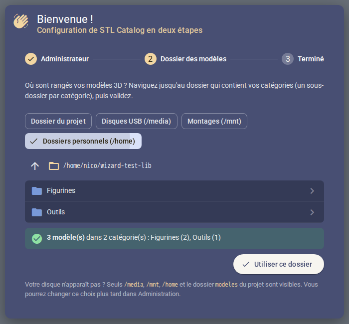
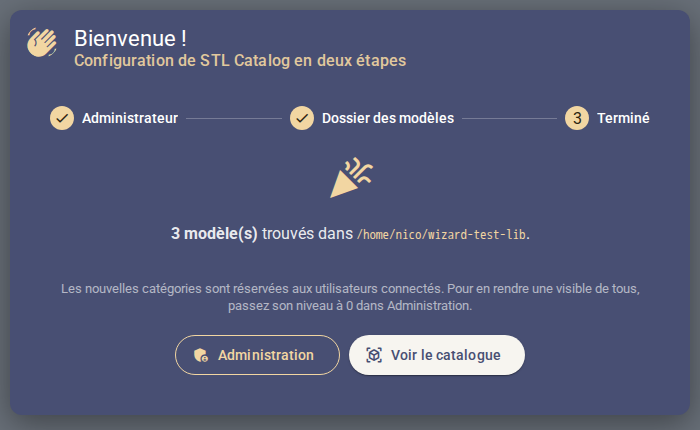

# STL Catalog

Catalogue web de modèles d'impression 3D, auto-hébergé. On dépose ses modèles (dossiers ou
archives zip / rar / 7z) dans un dossier, le catalogue les indexe tout seul et permet de les
**visualiser en 3D dans le navigateur** sans rien décompresser à la main.

© 2020–2026 Nicolas ELIE


## Fonctionnalités

- **Indexation automatique** du dossier `modeles/` au démarrage, toutes les 10 minutes et à la
  demande (bouton *Rescanner* dans l'administration). Ajouts, modifications et suppressions sont
  répercutés en base.
- **Archives zip, rar et 7z** lues sans extraction complète : seul le fichier consulté est
  extrait, puis mis en cache.
- **Viewer 3D** ([Online 3D Viewer](https://github.com/kovacsv/Online3DViewer)) : STL, OBJ+MTL,
  3MF, STEP/IGES, PLY, AMF, OFF, glTF, FBX, 3DS, DAE.
- **Aperçu de tous les fichiers** d'un modèle : images (zoom, taille réelle 1:1, déplacement),
  textes (README, gcode…), PDF.
- **Téléchargement** du modèle complet (archive d'origine, ou zip généré pour un dossier) ou
  d'un fichier seul.
- **Catégories avec niveaux d'accès** : 0 = public, 1 = modérateur, 2 = administrateur.

| Liste d'une catégorie | Visualiseur d'images |
| --- | --- |
|  |  |

## Installation

Prérequis : un Raspberry Pi 4 ou 5 (2 Go de RAM ou plus) sous **Raspberry Pi OS 64 bits**, ou
n'importe quel Linux Debian/Ubuntu 64 bits.

```bash
sudo apt install -y git
git clone https://github.com/themaire/catalog.git
cd catalog
./install.sh
```

Le script :

- vérifie le système (64 bits obligatoire, mémoire) ;
- installe Docker s'il est absent (script officiel get.docker.com) et l'active au démarrage ;
- crée le fichier `.env` avec des mots de passe aléatoires ;
- construit et lance l'application (quelques minutes la première fois sur un Pi).

Le catalogue est ensuite accessible sur `http://<ip-du-pi>:8090` (port réglable via
`FRONTEND_PORT` dans `.env`). Il redémarre tout seul après un reboot ou un plantage.

**Premier lancement** : la première ouverture du site lance un assistant en deux étapes :

1. choisir le mot de passe du compte administrateur `admin` ;
2. choisir le dossier où sont rangés les modèles, avec un explorateur qui montre ce qui y est
   détecté (catégories, nombre de modèles) avant de valider.

La première personne du réseau qui ouvre le site fait cette configuration : la faire juste après
l'installation. Mot de passe et dossier se changent ensuite dans *Mon compte* et *Administration*.

| Choix du dossier des modèles | Fin de l'assistant |
| --- | --- |
|  |  |

L'explorateur ne montre que des noms de dossiers et n'est accessible qu'à l'administrateur. Un
dossier illisible (droits Unix d'un autre utilisateur) est signalé par « Accès refusé ».

## Ajouter des modèles

Le dossier des modèles se choisit dans l'assistant ou dans *Administration*. L'explorateur donne
accès, en lecture seule, à `/media` (disques USB, même branchés après le démarrage), `/mnt`
(NAS, disques montés à la main), `/home` et au dossier `modeles` du projet. Il s'organise ainsi :

```
modeles/
├── thingiverse/                  ← une catégorie = un dossier
│   ├── Arduino_Uno_Snug_Case/    ← un modèle = un dossier…
│   │   ├── files/boitier.stl
│   │   └── images/photo.jpg
│   └── Support_casque.zip        ← … ou une archive zip / rar / 7z
└── perso/
```

- Une catégorie inconnue est créée automatiquement au niveau `SCAN_NEW_CATEGORY_LEVEL`
  (1 = modérateur par défaut). Pour la rendre publique, passer son niveau à 0 dans
  *Administration*.
- La vignette d'un modèle est la première image trouvée dans son dossier ou son archive.
- Ces emplacements sont montés **en lecture seule** : le catalogue ne modifie jamais les modèles.
  Changer de dossier retire du catalogue les modèles absents du nouveau dossier.
- Un dossier ailleurs sur la machine : soit l'indiquer dans `MODELS_DIR` (fichier `.env`), soit
  ajouter un montage dans `docker-compose.yml`.
- Seuls les exemples `modeles/thingiverse/` sont versionnés, le reste du dossier est ignoré par
  git.

## Mise à jour

```bash
git pull
./install.sh
```

Les données (base MariaDB, cache des fichiers extraits) sont dans les volumes Docker `db-data` et
`extract-cache` et survivent aux mises à jour.

## Architecture

| Service | Rôle |
| --- | --- |
| `frontend` | Angular servi par Nginx, proxy `/api` vers le backend ([modern/frontend](modern/frontend)) |
| `backend` | API Node/Express, scan planifié, extraction des archives via `7z` ([modern/backend](modern/backend)) |
| `db` | MariaDB 10.11, initialisée par [lib3d_bdd.sql](lib3d_bdd.sql) |

Pour le debug, `docker-compose.debug.yml` publie aussi MariaDB et l'API sur `127.0.0.1` :
`docker compose -f docker-compose.yml -f docker-compose.debug.yml up -d`.

Le détail de l'API et des variables d'environnement est dans
[modern/backend/README.md](modern/backend/README.md).

## Ancienne version PHP

L'application PHP d'origine (2020, Apache + PHP installés directement sur Raspberry Pi OS) n'est plus
maintenue. Elle reste disponible dans l'historique git sous l'étiquette `php-legacy` :

```bash
git checkout php-legacy
```
